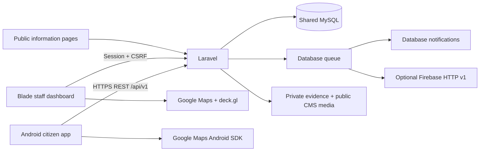

# Architecture

Laravel 12.70.1 on PHP 8.4.27 owns schema, authorization, transactions and routing. Web sessions and Sanctum mobile tokens reach the same controllers and MySQL 8.4 database. Android never connects to MySQL. Backend Composer and frontend npm versions are resolved in lockfiles. Android dependencies are pinned and resolved in Gradle lockfiles; AGP 8.13.2, Kotlin 2.2.21, Gradle 8.13, compile/target SDK 36, min SDK 26, JDK 21 are the tested compatibility set.

Submission is a transaction: incident + initial history + notification jobs. Notifications are dispatched after commit. Database uniqueness on reporter/idempotency_key prevents duplicate rows. A request hash rejects reuse with different content. Every sensitive record operation uses IncidentPolicy; every collection and analytic query starts from visibleTo. Status changes lock the row and recheck authorization, so concurrent rerouting does not allow an obsolete agency to modify a report.

Roles are fixed application roles (`admin`, `officer`, `citizen`); officers have one agency assignment. This implements the source roles by assignment rather than creating separate police/fire/MDRRMO authentication systems. A configurable fine-grained permission editor and multiple agency membership are not yet implemented.

Routing matches category and administrator-configured latitude/longitude rectangles against active agencies. No matching rectangle or overlapping rectangles for conflicting agencies results in unassigned triage. Rectangular rules do not model arbitrary polygons; operational boundaries must be confirmed before configuring them. Agency jurisdiction text remains informational.

Coordinates are the incident location. Fresh foreground GPS requires accuracy and an observation timestamp; manual pins explicitly carry no measured accuracy. Server timestamps are UTC; operational presentation uses Asia/Manila. Date filters are interpreted as Asia/Manila calendar dates and converted to UTC query bounds.

Heatmap cells are 0.01 degrees (latitude-dependent area), with a minimum count of three, one event = one weight. Exclude test, rejected and duplicate incidents, and by default unvalidated reports and GPS accuracy worse than 100 m. Manual pins are explicitly unmeasured. Cells return no names, user IDs, messages, or exact reporter locations. Exploratory mode is explicitly labeled. These thresholds are an initial privacy measure, not a formal privacy guarantee. Dashboard list and summary use common filters; heatmap intentionally applies stricter inclusion rules. Requests support bounding boxes and are capped at 1,000 cells, lists at 25/page, exports at 10,000 rows.
