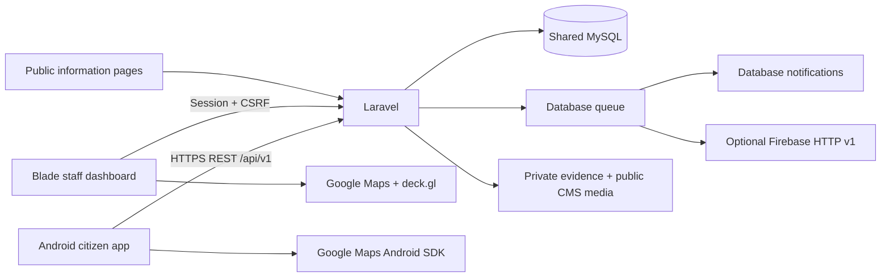

# Architecture

Laravel 12.70.1 on PHP 8.4.27 owns schema, authorization, transactions and routing. Web sessions and Sanctum mobile tokens reach the same controllers and MySQL 8.4 database. Android never connects to MySQL. Backend Composer and frontend npm versions are resolved in lockfiles. Android dependencies are pinned and resolved in Gradle lockfiles; AGP 8.13.2, Kotlin 2.2.21, Gradle 8.13, compile/target SDK 36, min SDK 26, JDK 21 are the tested compatibility set.

Submission is a transaction: incident + initial history + notification jobs. Notifications are dispatched after commit. Database uniqueness on reporter/idempotency_key prevents duplicate rows. A request hash rejects reuse with different content. Every sensitive record operation uses IncidentPolicy; every collection and analytic query starts from visibleTo. Status changes lock the row and recheck authorization, so concurrent rerouting does not allow an obsolete agency to modify a report.

Roles are fixed application roles (`admin`, `officer`, `citizen`); officers have one agency assignment. This implements the source roles by assignment rather than creating separate police/fire/MDRRMO authentication systems. A configurable fine-grained permission editor and multiple agency membership are not yet implemented.

Routing uses the active BFP, PNP or MDRRMO agency linked to the selected active category. Missing or inactive agencies/mappings go to triage. The Dispatch Rules module is retired; old rectangle and agency-routing settings remain stored for history but are no longer consulted. Agency jurisdiction text remains informational.

Coordinates are the incident location. Fresh foreground GPS requires accuracy and an observation timestamp; manual pins explicitly carry no measured accuracy. Server timestamps are UTC; operational presentation uses Asia/Manila. Date filters are interpreted as Asia/Manila calendar dates and converted to UTC query bounds.

Heatmap cells are 0.01 degrees (latitude-dependent area), with a minimum count of three, one event = one weight. Exclude test, rejected and duplicate incidents, and by default unvalidated reports and GPS accuracy worse than 100 m. Manual pins are explicitly unmeasured. Cells return no names, user IDs, messages, or exact reporter locations. Exploratory mode is explicitly labeled. These thresholds are an initial privacy measure, not a formal privacy guarantee. Dashboard list and summary use common filters; heatmap intentionally applies stricter inclusion rules. Requests support bounding boxes and are capped at 1,000 cells, lists at 25/page, exports at 10,000 rows.

## Agency catalog

The shared agency/category catalog uses Fire Department (BFP), Police Department (PNP), and MDRRMO, in that order. Existing internal types FIRE, PNP, and MDRRMO remain stable identifiers; FIRE represents BFP. The data migration renames existing agency and default-category rows in place and creates missing defaults. IDs, existing incident references, staff assignments, dispatch rules, contact details, activation flags and custom incident categories are preserved. Both Blade and Android use this backend catalog, and CSV exports include agency names. Initial web and Android incident-map views center on San Jose del Monte, Bulacan (14.8139, 121.0453; zoom 13); map centering does not configure dispatch jurisdiction or preselect an incident location.

For an existing deployment run `php artisan migrate --force` after deploying this revision. Fresh setup and repeatable seeding also install these labels without duplicating catalog entries.

## Report status and separate map

Report status is `need_action` or `done`, with reversible staff actions and a recorded history/audit. The Incident accessor and status-query scope normalize older stored states without a destructive migration: resolved/closed/rejected/duplicate are Done, and remaining legacy values are Need action. New reports start at Need action. Verification is independent of completion and continues to control validated heatmap inclusion.

`/dashboard` renders the report table, including address and coordinates, without loading Google Maps or the map overlay. `/incident-map` uses the same authorized filters and paginated report data for agency icons/heatmap, and opens report details from pins. Switching pages preserves the filter query. CSV includes the visible status label and location/coordinates. Infographics is retired and the public home page now shows announcements; historical infographic records and files are preserved.

## Page CMS and shared visual theme

`PublicPage` stores the five public pages' small header label, heading, introductory paragraph and contact-form text. Typed content records continue to store repeatable items and images. `/manage/cms` groups the five editors while preserving their existing URLs. Metadata reads are public; settings writes require verified administrator authentication, use an explicit field allowlist, and record audit before/after values. Plain page text is escaped by Blade; item rich text continues through HTMLPurifier. The page migration creates defaults once and seeder reruns do not overwrite edits.

Web CSS design tokens and Android `ui/theme/Theme.kt` share the reference palette. Branding affects surfaces and controls while map marker colors retain their existing agency meaning. Responsive staff navigation collapses on small screens. Native Android light/night resources and API-qualified navigation bar settings accompany the Compose theme.
