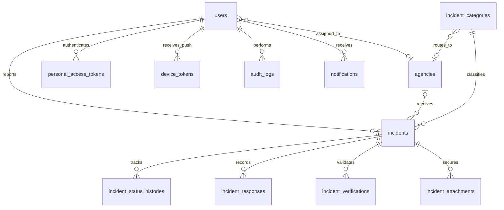

# Entity relationship diagram

CMS uses a typed `contents` table for announcements, infographics, services, team members, contact details and FAQs, with sanitized body, publication flag, optional image and validated metadata. This intentionally consolidates identical publishing lifecycles. `contact_messages` has soft-delete trash/restore. `jobs`, `failed_jobs`, `job_batches`, `cache`, `sessions`, and `password_reset_tokens` use Laravel migrations. Incident evidence has restrictive foreign keys rather than cascading deletion. Users are deactivated rather than physically deleted by management endpoints.
