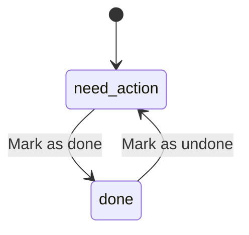

# Permissions

| Operation | Public | Citizen | Agency officer | Administrator |
|---|---|---|---|---|
| Published CMS and contact form | Yes | Yes | Yes | Yes |
| Submit incident | No | Verified, own identity | No | No |
| View incidents | No | Own only | Assigned agency | All, including triage |
| Status, verify, response note | No | No | Assigned agency | All |
| Verify own reported incident | No | No | No | No |
| Assign officer | No | No | Officer in same agency | Any active officer in routed agency |
| Reroute agency | No | No | No | Yes, audited |
| Heatmap, trends, CSV | No | No | Agency scope | All |
| CMS/users/messages/audit | No | No | No | Yes |
| Profile/password/email | No | Own | Own | Own |
| Incident evidence | No | Own incident | Agency scope | All |

Inactive users are rejected by middleware, including previously issued tokens. Account changes revoke mobile tokens. Password changes/resets revoke tokens and rotate remember tokens. Web forms use Laravel CSRF protection. APIs use policy checks regardless of UI controls. Admin cannot remove their own admin access through account management.

Only authorized staff may mark reports done or undone. Status history records actor, timestamp and note; a default action note is recorded when none is supplied. Citizen status is read-only. A repeated request for the current state is a no-op. Completion is separate from verification: marking done does not validate a report for the heatmap. Verification retains its dedicated endpoint and rationale requirement.

Legacy resolved, closed, rejected and duplicate states display/filter as Done; other legacy states display/filter as Need action. Reading old reports does not rewrite stored historical values. New state changes use `done` and `need_action`.

The report dashboard is `/dashboard`; the separately authorized map is `/incident-map`. Dispatch Rules and Infographics management/public endpoints are retired. Historical records remain stored; automatic routing uses the active agency linked to the incident category.
