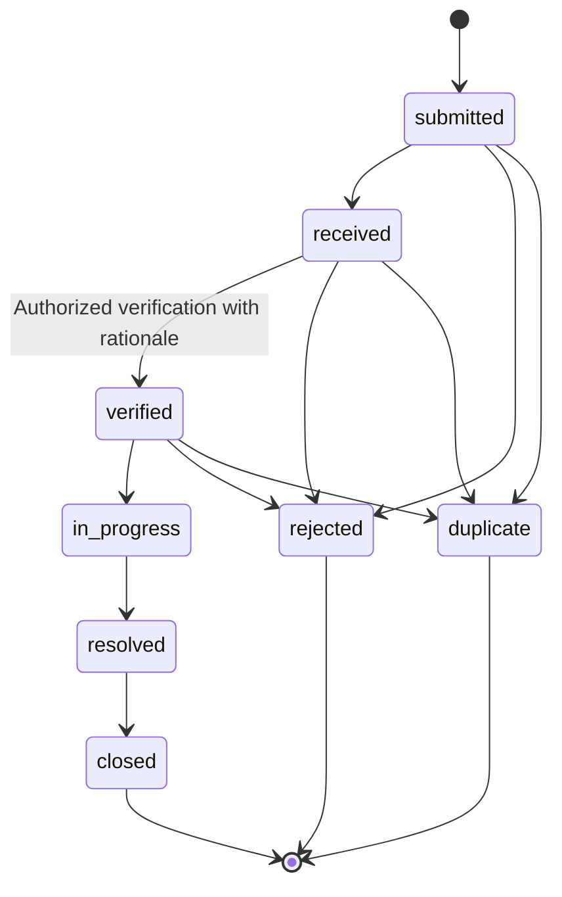

# Permissions

| Operation | Public | Citizen | Agency officer | Administrator |
|---|---|---|---|---|
| Published CMS and contact form | Yes | Yes | Yes | Yes |
| Submit incident | No | Verified, own identity | No | No |
| View incidents | No | Own only | Assigned agency | All, including triage |
| Status, verify, response note | No | No | Assigned agency | All |
| Verify own reported incident | No | No | No | No |
| Assign officer | No | No | Officer in same agency | Any active officer in routed agency |
| Reroute agency | No | No | No | Yes, audited |
| Heatmap, trends, CSV | No | No | Agency scope | All |
| CMS/users/messages/audit | No | No | No | Yes |
| Profile/password/email | No | Own | Own | Own |
| Incident evidence | No | Own incident | Agency scope | All |

Inactive users are rejected by middleware, including previously issued tokens. Account changes revoke mobile tokens. Password changes/resets revoke tokens and rotate remember tokens. Web forms use Laravel CSRF protection. APIs use policy checks regardless of UI controls. Admin cannot remove their own admin access through account management.

Verification must use its dedicated endpoint. Status history records actor, timestamp and note; citizen status is read-only. Reopening terminal incidents is deliberately unavailable until an explicit operational policy is supplied.
